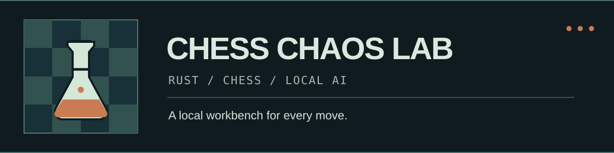
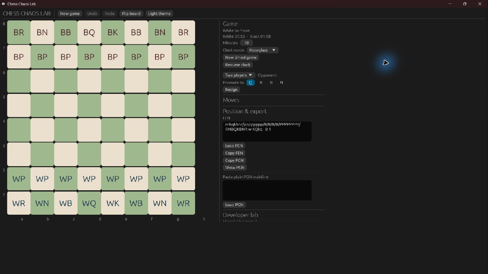

<p align="center"></p>

# Chess Chaos Lab

**A local chess workbench for playing, testing ideas, and connecting your own UCI engine.** Built as a four-crate Rust desktop application. The current `0.1.0` codebase is an early playable build for Windows x64, with a deliberately limited PGN importer and basic internal AI.

[](https://www.rust-lang.org/) [](docs/build.md) [](https://github.com/ViolaPeracia/chess-chaos-lab/actions/workflows/ci.yml) [](LICENSE)

[Website](https://violaperacia.github.io/chess-chaos-lab/) · [Documentation](https://violaperacia.github.io/chess-chaos-lab/docs/) · [Roadmap](docs/ROADMAP.md) · [Issues](https://github.com/ViolaPeracia/chess-chaos-lab/issues) · [Contributing](CONTRIBUTING.md)

## Current status

The M0 source passes 27 automated tests, formatting, Clippy, and a release build on the development Windows x64 machine as of 9 November 2026. A [Windows desktop audit](docs/m0-windows-audit.md) covers the main GUI paths, keyboard play, Narrator speech, and display scaling. See the [feature matrix](docs/feature-matrix.md) and [test evidence](docs/testing.md) for scope limits.

## Screenshot



Actual Windows x64 release build captured on 9 November 2026. The restored hourglass game is paused after restart. The banner above is original project artwork.

## What works

- Standard chess moves and outcomes using `shakmaty`, with two players on one device.
- Four basic local AI move policies and internal AI versus AI autoplay.
- FEN load/copy, one plain PGN mainline import/export, undo/redo in untimed games, and one-game autosave.
- Fischer, Bronstein, and hourglass clocks.
- One-shot analysis with a user-supplied local UCI executable, or play White against it. No external engine is bundled.

## Planned

Full PGN, broader chess edge-case testing, robust engine matches, game library, analysis/review, training, tournaments, variants, statistics, and broader accessibility validation are on the [roadmap](docs/ROADMAP.md). These are not part of the current release.

## Download and quick start

Check [the latest release page](https://github.com/ViolaPeracia/chess-chaos-lab/releases/latest) for the Windows ZIP and `SHA256SUMS.txt`. Verify the checksum, extract the ZIP, then run `chess-chaos-lab.exe`. If no release is published yet, build from source below.

Choose **Two players** for local play. Select an internal opponent to play White against an AI, or **Computer vs computer** with **Autoplay** to watch two internal policies. Full instructions are in the [user guide](docs/user-guide.md).

## Build from source

Windows x64, a current stable Rust toolchain, and Visual Studio C++ Build Tools with the Windows SDK are required for the verified build path. From the repository root:

```powershell
cargo build --release --locked
.\target\release\chess-chaos-lab.exe
```

Dependencies may download during the first build. Linux and installers have not been validated. See [build details](docs/build.md).

## Configuration and dependencies

There is no account, API key, or required environment variable. The optional engine path is entered in the app. The workspace uses `shakmaty` for standard chess rules, `eframe`/`egui` for the desktop UI, and the Rust standard library for UCI process handling. `Cargo.lock` pins the full build graph. The documentation site separately uses Astro and Starlight.

## Local UCI engines

Provide the full path to a trusted UCI engine executable in the app. The engine runs as a local process with your user permissions. One Stockfish 19 move and one-second analysis were reported in the prior GUI smoke run; this is not a full-engine-match qualification. [Engine guide](docs/engine-integration.md).

## Architecture and development

`chess-core` owns rules, game state, notation, and clocks; `chess-ai` selects local moves; `chess-uci` manages one-shot engine processes; `chess-chaos-lab` is the native UI and autosave layer. [Architecture](docs/architecture.md) · [Development and tests](docs/testing.md) · [Release process](docs/release.md).

## Contributing and license

Read [CONTRIBUTING.md](CONTRIBUTING.md) and [AGENTS.md](AGENTS.md) before making changes. The existing project declares **GPL-3.0-or-later** in its Cargo manifests and includes the license text in [LICENSE](LICENSE). This repository retains that declared status; distribution should include the corresponding source and notices.

## Known limitations

PGN accepts one plain mainline, autosave stores one game without a backup UI, and real-engine timeout and full-match behavior remain unverified. The [M0 keyboard and Narrator audit](docs/m0-windows-audit.md) covers the baseline desktop paths. See the [full limitations](docs/known-limitations.md).

## Contact

Use [GitHub Issues](https://github.com/ViolaPeracia/chess-chaos-lab/issues) for bugs and requests, [Discussions](https://github.com/ViolaPeracia/chess-chaos-lab/discussions) for questions, and the private reporting route in [SECURITY.md](SECURITY.md) for vulnerabilities.
