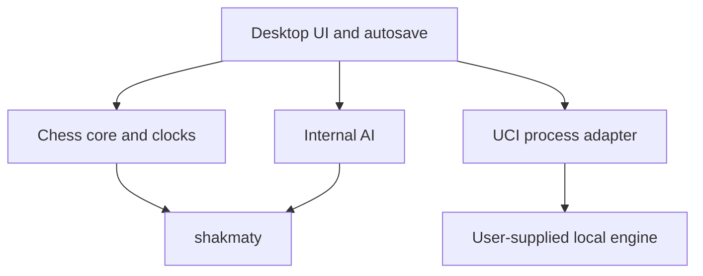

# Architecture

The Cargo workspace has four actual modules:

| Crate | Responsibility |
| --- | --- |
| `chess-chaos-core` | Standard chess game state, legal move boundary, draw bookkeeping, Fischer/Bronstein/hourglass clock model, FEN, SAN, limited PGN, save format. Uses `shakmaty` 0.30.2. |
| `chess-chaos-ai` | Four independent local move selectors, material evaluation, depth-three alpha-beta, perft. |
| `chess-chaos-uci` | Launches an explicitly supplied executable, UCI handshake, bounded waits, one-shot analysis, process termination. |
| `chess-chaos-lab` | `eframe` 0.37 / `egui` native UI, background workers, local autosave. |

The UI never decides whether a move is legal. `Game` owns a position snapshot at each ply; undo/redo moves the cursor, and a new move truncates the redo branch. The core clock model owns remaining time, clock mode, bonus or delay, active side and pause state. The save file contains a start FEN, UCI moves, result state and optional clock line. Older Fischer clock saves remain readable. Timed games resume paused after restart. There is no network client or web runtime in the application.

The current AI uses one worker thread per move so search does not block rendering. UCI analysis and engine replies likewise run on worker threads. The GUI requests a UCI best move, then the core validates it against the current position. This is a simple architecture for one board, not a tournament scheduler. Engine CPU/memory isolation and worker cancellation remain to be built.

Design choice: `shakmaty` supplies tested legal move generation and notation, avoiding a new hand-written rules engine. Its GPL-3.0-or-later license determines this project's license. The eframe glow backend provides native rendering without Electron.

